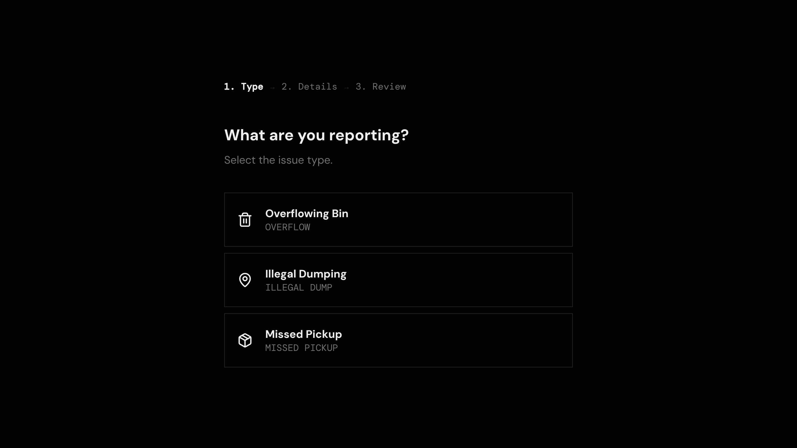

# CleanCity

CleanCity is a web application for reporting overflowing bins, illegal dumping, and missed waste pickups under UN SDG 11.6. Citizens submit geotagged photo reports, operations staff triage and assign work, and field crews record completion photos and notes.

Built with Next.js 16, Convex, an OpenAI-compatible vision and text API, and OpenStreetMap via Leaflet.

## Screenshot



## Setup

### Prerequisites

- [Bun](https://bun.sh) runtime
- [Convex](https://convex.dev) account and project
- OpenAI-compatible API key such as [DeepSeek](https://api-docs.deepseek.com/)

### Environment variables

Create `.env.local` in the project root:

```bash
CONVEX_DEPLOYMENT=dev:your-deployment-name
NEXT_PUBLIC_CONVEX_URL=https://your-deployment-name.convex.cloud
NEXT_PUBLIC_CONVEX_SITE_URL=https://your-deployment-name.convex.site
INTERNAL_AI_SECRET=random-secret-for-internal-ai-calls
DEEPSEEK_API_KEY=sk-...
OPENAI_BASE_URL=https://api.deepseek.com
OPENAI_MODEL=deepseek-v4-pro
OPENAI_VISION_MODEL=deepseek-v4-pro
AI_PROVIDER=deepseek
```

Any OpenAI-compatible base URL works. Set `OPENAI_MODEL=deepseek-v4-flash` to use a smaller model for text tasks while keeping `OPENAI_VISION_MODEL=deepseek-v4-pro` for image analysis.

### Database and backend

Convex schema and backend functions live in `convex/`. Push the schema and functions to your development deployment:

```bash
bunx --bun convex dev --once
```

### Install and run

```bash
bun install
bun run seed
bun run dev
```

The development server listens on `http://localhost:3000`.

`bun run seed` creates or updates one staff user per role in Convex using credentials from `src/lib/seed-accounts.ts`. The login page does not display these credentials.

| Role | Email | Password |
|------|-------|----------|
| ops | ops@cleancity.dev | password123 |
| crew | crew@cleancity.dev | password123 |

## Architecture

- **Authentication.** Convex `users` and `sessions` tables store staff accounts and session tokens. Next.js sets an HTTP-only `cleancity_session` cookie on sign-in.
- **Database.** Convex document tables store `reports`, `activities`, `users`, `sessions`, `ai_runs`, `ai_image_cache`, and `ai_weekly_insights` with indexed queries.
- **Storage.** Convex file storage holds report before and after photos and generates signed URLs on read.
- **AI pipeline.** The server calls an OpenAI-compatible chat completions endpoint to detect garbage in photos, assess triage severity, draft crew briefings, find nearby duplicate reports, and write resolution notes.
- **Maps.** Leaflet renders OpenStreetMap tiles with a Carto dark basemap and geohash hotspot overlays.
- **Interface.** Tailwind CSS v4 styles the monochrome layout with DM Sans and DM Mono fonts.

### API routes

| Group | Routes |
|-------|--------|
| Auth | login, logout |
| Reports | create, list, detail, activities, assign, complete, triage, status, duplicates, merge, export |
| Analytics | summary, hotspots |
| Users | list staff by role |
| AI | process-report, process-completion, garbage-check, triage, crew-brief, duplicates, public-note, status, retry-pending, run-weekly-insights |

## Build and deploy

Run the local production build:

```bash
bun run build
```

Deploy Convex functions to production and publish the Next.js worker to Cloudflare:

```bash
bunx --bun convex deploy
bun run deploy
```
